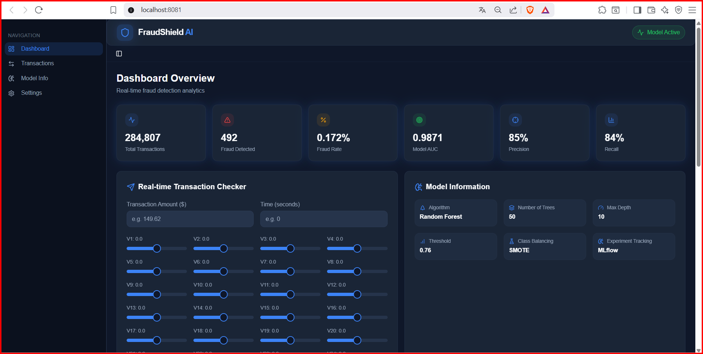
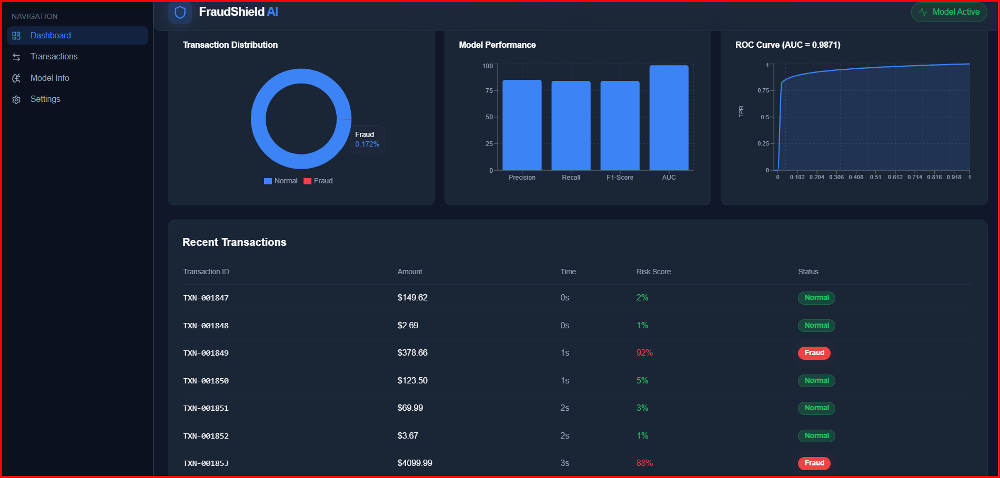
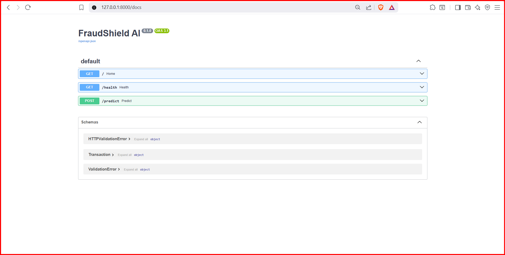
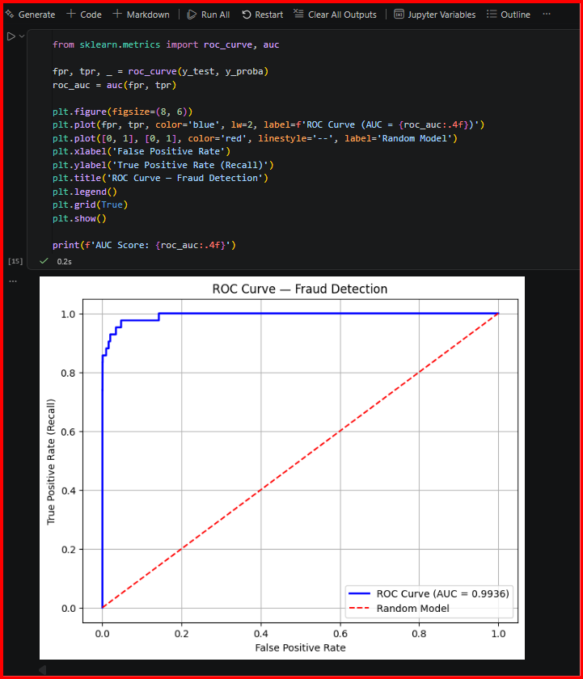

# 💳 Détection de fraude bancaire — Machine Learning, FastAPI, React & MLflow

Application complète de détection de transactions frauduleuses par carte bancaire : analyse des données, entraînement d'un modèle de machine learning suivi avec MLflow, API de prédiction FastAPI et tableau de bord web React.



---

## ✨ Fonctionnalités

- **Analyse exploratoire (EDA)** du dataset dans des notebooks Jupyter
- **Modèle de classification** entraîné pour repérer les transactions frauduleuses (fortement minoritaires)
- **Suivi des expériences** (paramètres, métriques, modèles) avec **MLflow**
- **API de prédiction** avec **FastAPI**
- **Tableau de bord web** en **React / TypeScript** pour visualiser les résultats et tester des transactions
- **Lancement en une commande** avec **Docker Compose**

---

## 🖼️ Aperçu

| Tableau de bord | Vue détaillée |
|---|---|
|  |  |

| Prédiction d'une transaction | Courbe ROC du modèle |
|---|---|
|  |  |

---

## 🗂️ Structure du projet

```
fraud_detection_project/
├── api/              # API de prédiction (FastAPI)
├── code/             # Scripts Python
├── data/             # Emplacement du dataset (non inclus dans le dépôt)
├── docs/             # Captures d'écran
├── frontend/         # Tableau de bord (React, TypeScript, Vite, Tailwind)
├── models/           # Modèle entraîné (fraud_model.pkl)
├── notebooks/        # Analyse exploratoire et entraînement
├── docker-compose.yml
└── requirements.txt
```

---

## 📊 Données

Dataset public **Credit Card Fraud Detection** (Kaggle) : transactions par carte bancaire, avec une très faible proportion de fraudes.

👉 https://www.kaggle.com/datasets/mlg-ulb/creditcardfraud

Le dataset n'est pas inclus dans le dépôt (fichier trop lourd). Téléchargez-le et placez-le dans le dossier `data/`.

---

## 🚀 Lancer le projet

### Avec Docker (recommandé)

```bash
docker-compose up --build
```

La documentation interactive de l'API est disponible sur `/docs` (Swagger, généré par FastAPI).

### Sans Docker

```bash
# Backend
python -m venv venv
venv\Scripts\activate        # Windows  (source venv/bin/activate sous Linux/Mac)
pip install -r requirements.txt

# Frontend
cd frontend
npm install
npm run dev
```

---

## 🛠️ Stack technique

**Data & ML :** Python · Pandas · Scikit-learn · Jupyter · MLflow
**Backend :** FastAPI
**Frontend :** React · TypeScript · Vite · Tailwind CSS
**Déploiement :** Docker · Docker Compose

---

## 👤 Auteur

**Adnen Kammoun** — Data Engineer · Élève ingénieur Data Science & IA (TEK-UP University)
[LinkedIn](https://www.linkedin.com/in/adnen-kammoun-b350a425b) · [GitHub](https://github.com/adnenkammoun)
